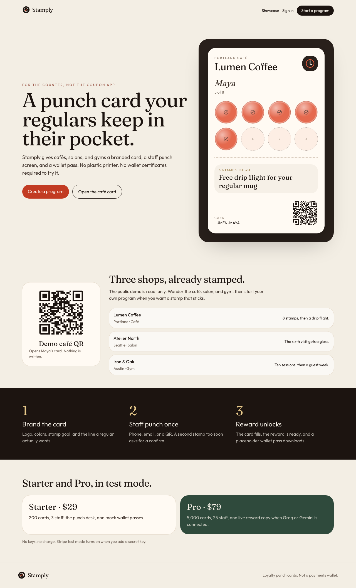
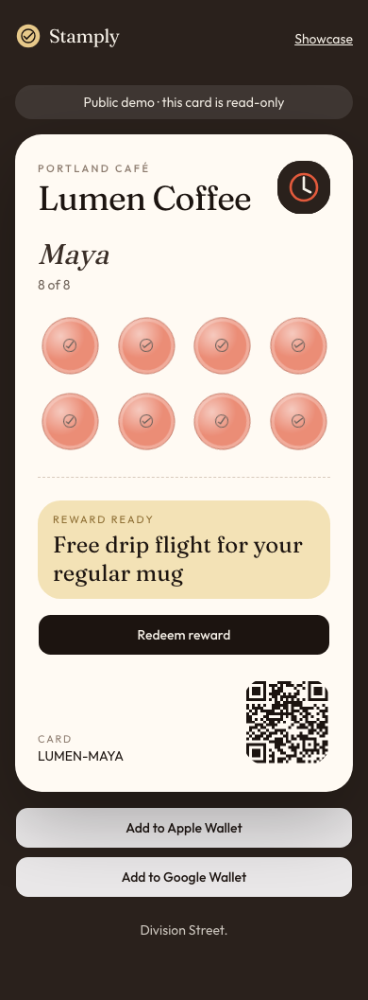
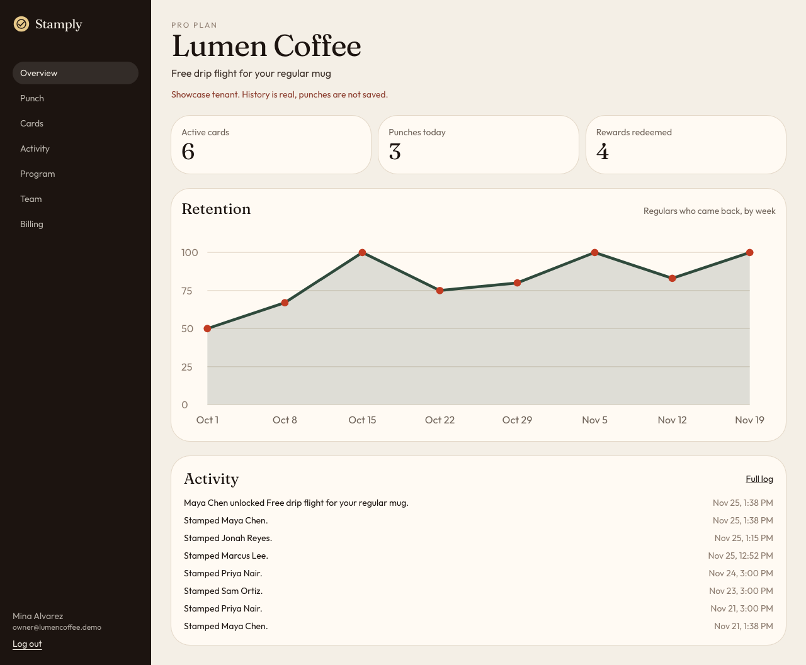
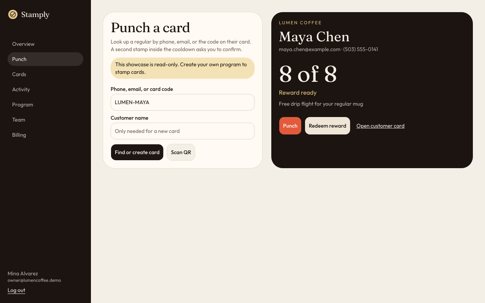

# Stamply

White-label loyalty punch cards for cafés, salons, and gyms. A merchant brands the card, staff stamp it by phone, email, or QR, and the customer opens a public link to see progress, unlock a reward, and download a wallet pass preview.

The app runs with **zero environment variables**. Database, Stripe, email, reward copy, and wallet signing all fall back to mock mode. Live keys are optional and documented in [`.env.example`](.env.example).

Target demo: [stamply.quvantic.com](https://stamply.quvantic.com). This is a loyalty punch card, not a payments or crypto wallet.

## Screenshots









## Run locally

```bash
npm install
npm run dev
```

The dev server listens on [http://127.0.0.1:43123](http://127.0.0.1:43123).

```bash
npm run build
npm run start
npm test
npm run test:e2e
```

`npm test` covers punch cooldown, reward unlock, showcase read-only, tenant isolation, and the mock wallet. Playwright covers the same path in a browser and is what CI runs.

## Try the showcase

Password for every seeded login: `stamply-demo`

| Role | Email |
| --- | --- |
| Lumen Coffee owner | `owner@lumencoffee.demo` |
| Lumen Coffee staff | `staff@lumencoffee.demo` |
| Atelier North owner | `owner@ateliernorth.demo` |
| Atelier North staff | `staff@ateliernorth.demo` |
| Iron & Oak owner | `owner@ironandoak.demo` |
| Iron & Oak staff | `staff@ironandoak.demo` |
| Super admin | `admin@stamply.dev` |

The public demo is read-only. **Demo café QR** on the landing page opens Maya Chen’s card at `/c/LUMEN-MAYA?demo=1`. Redeem and punch are refused, so the next visitor still sees 8 of 8 and a reward ready to show. Nina Park at Atelier North is also unlocked.

Create a program from **Start a program** when you want stamps that stick. That tenant lives in a signed cookie in this browser. It is not shared across devices, and it resets if the cookie is cleared. Connect Supabase before you treat it as production data.

A second stamp on the same card inside 90 seconds asks the staff to confirm. Set `PUNCH_COOLDOWN_SECONDS` to change that.

## Mock wallet

`WalletProvider` is the seam for Apple Wallet and Google Wallet. Without certificates the provider is in **mock** mode:

- **Add to Apple Wallet** and **Add to Google Wallet** open a pass preview.
- Apple downloads an unsigned `.pkpass` zip (`pass.json` plus a note). Apple Wallet will not install it.
- Google downloads an unsigned JSON save payload. It is not a Google Wallet JWT.

The preview never moves money. When you add the Apple or Google env vars, the provider reports that keys were detected and still returns the placeholder until a signer is plugged into `lib/wallet.ts`.

## What turns on with env vars

| Capability | Missing keys | With keys |
| --- | --- | --- |
| Database and auth | Signed cookie plus the seeded showcase | Supabase Auth and Postgres. RLS is in `supabase/migrations` |
| Billing | Starter / Pro switch in the browser, no card | Stripe test Checkout. Webhook updates `tenants.plan` when the service role is set |
| Email | Super-admin outbox | Resend |
| Reward copy | Three studio lines | Groq, otherwise Gemini. Live copy is a Pro feature |
| Wallet | Preview and placeholder file | Keys are detected; signing stays behind `WalletProvider` |

Apply the migration in the Supabase SQL editor, then:

```bash
npm run seed:supabase
```

That creates the showcase logins. Card history in hosted mode still needs rows inserted for those tenants, or you can ignore the seed and use programs created in the app.

Disable email confirmation on the Supabase project, or signup cannot open a session to call `create_merchant_tenant`.

## What Mustafa needs to provide

For [stamply.quvantic.com](https://stamply.quvantic.com) on Vercel project `stamply`:

1. DNS for `stamply.quvantic.com` pointing at the Vercel project.
2. `SESSION_SECRET` — a long random string.
3. Supabase project URL, publishable or anon key, and service role key. Run the migration. Optionally `npm run seed:supabase`.
4. Stripe test secret, webhook secret, and price ids for Starter ($29) and Pro ($79). Point the webhook at `/api/stripe/webhook`.
5. Optional: `RESEND_API_KEY` and `EMAIL_FROM`.
6. Optional: `GROQ_API_KEY` or `GEMINI_API_KEY` for reward lines.
7. Optional, later: Apple pass certificate, key, pass type id, team id, and WWDR; Google Wallet issuer id and service account JSON. Do not commit the PEM files (`.gitignore` already ignores `*.pem`).

Nothing above is required to boot the preview. With an empty env, Vercel serves the landing page, the three showcase businesses, the read-only café card, and mock wallet buttons.

## CI

[`.github/workflows/ci.yml`](.github/workflows/ci.yml) runs on `ubuntu-latest` with no secrets: typecheck (`next typegen && tsc --noEmit`), lint, unit tests, `playwright install --with-deps`, production build, and Playwright. `@playwright/test` is 1.65.1 or newer.
